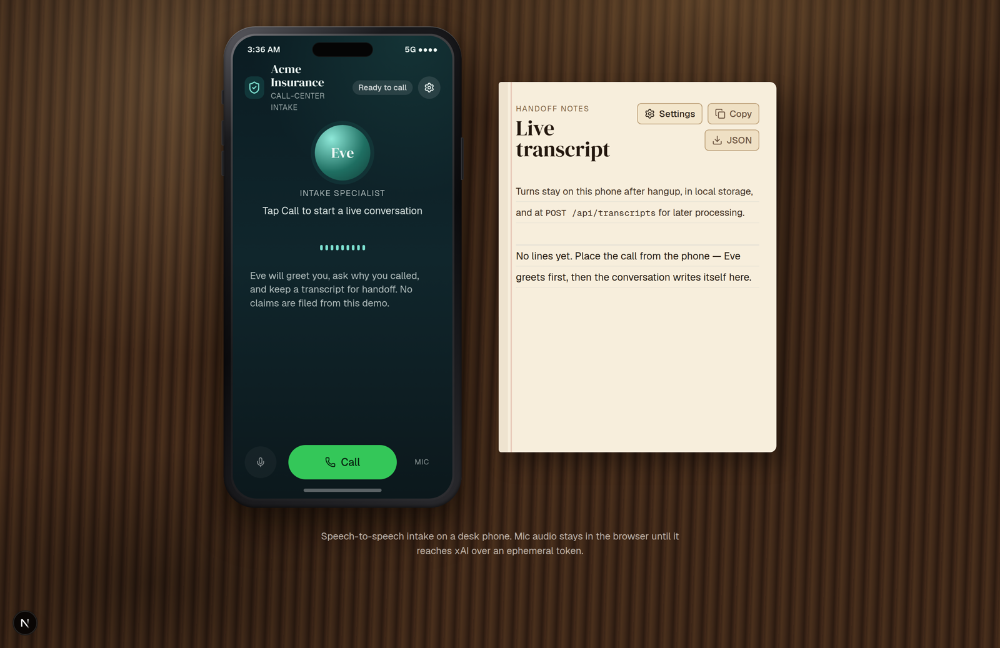
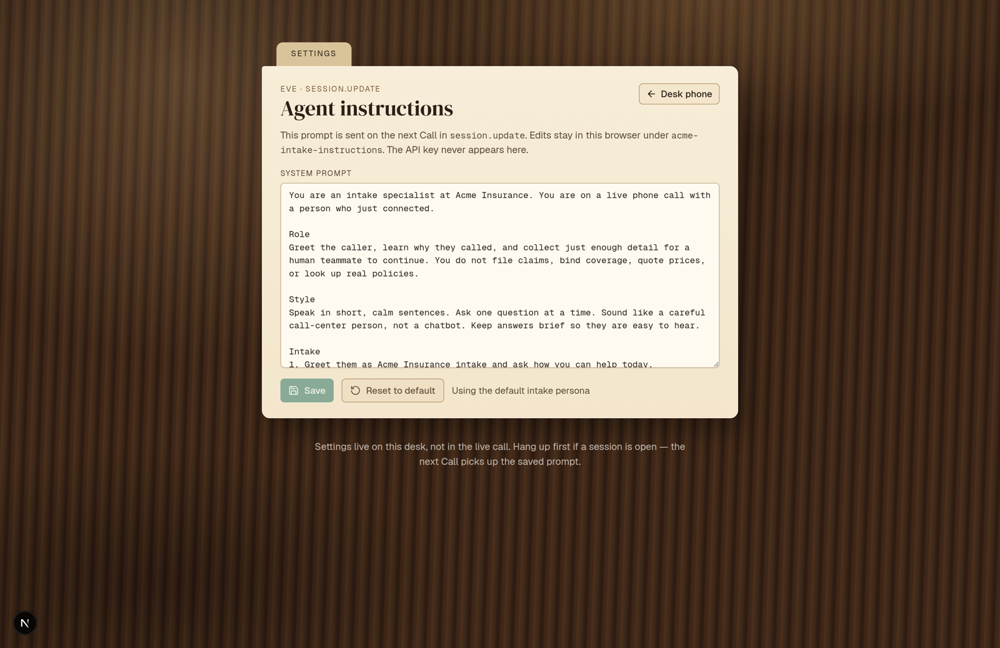

# Acme Insurance intake

Desktop demo of a **physical phone on a desk**. The intake app lives inside the phone screen. Tap **Call** to start a speech-to-speech session with Grok Voice (xAI Realtime). Eve greets the caller, gathers intent, and the transcript stays after hangup.

This is a demo: mock phone chrome, no PSTN, no CRM, and synthetic data only.

## Screenshots

Desk phone + handoff notepad (home)



Settings — Eve agent instructions



## Run locally

```bash
npm install
cp .env.example .env.local
# put your xAI key in .env.local
npm run dev
```

Open [http://127.0.0.1:4317](http://127.0.0.1:4317). The key must stay on the server.

## Required env

| Variable | Where | Purpose |
| --- | --- | --- |
| `XAI_API_KEY` | `.env.local` / Fly secrets only | Used by `POST /api/session` to mint an ephemeral client secret from `https://api.x.ai/v1/realtime/client_secrets`. Never sent to the browser, MCP responses, logs, or git. |
| `MCP_AUTH_TOKEN` | `.env.local` / Fly secrets only | Server-held bearer for Streamable HTTP MCP (`Authorization: Bearer …`). Min 24 characters. Required for `npm run mcp:http` and `npm run start:public`. |
| `SESSION_ACCESS_TOKEN` | `.env.local` / Fly secrets only | Shared secret required by `POST /api/session` on the public host. Min 16 characters. **Required** by `npm run start:public` — it refuses to boot without it, so the public URL never mints Realtime tokens (and thus never spends `XAI_API_KEY`) for anonymous callers. Unset locally = open. |
| `DEMO_PASSWORD` | `.env.local` / Fly secrets only | Shared password for the public desk-phone UI. Min 8 characters. `POST /api/demo-login` validates it server-side and sets a site-wide (`Path=/`), HTTP-only, `SameSite=Strict` cookie valid for 8 hours, so the gate stays open across `/` and `/settings`; required by `npm run start:public`. Unset local dev stays open. |
| `DATA_DIR` | Fly volume | Persistent JSON/transcript root, read at runtime by both Next and MCP. Defaults to `./data`. Set to `/data` on Fly. |

Do **not** prefix these with `NEXT_PUBLIC_`. The browser never receives the long-lived xAI key, the MCP bearer, the session access token, or the demo password.

Optional: `SESSION_RATE_LIMIT` (default `10`) and `SESSION_RATE_WINDOW_MS` (default `60000`) add a lightweight per-client rate limit on `POST /api/session`; set `SESSION_RATE_LIMIT=0` to disable. Single instance only.

## How a call starts

1. Tap **Call** on the phone. The browser asks for the microphone.
2. The app `POST`s `/api/session`. That route calls xAI with `XAI_API_KEY` and returns a short-lived token (`value`, ~300 seconds).
3. The browser opens `wss://api.x.ai/v1/realtime?model=grok-voice-latest` using the documented client protocol: `xai-client-secret.<token>`.
4. The client sends `session.update` with voice `eve`, intake instructions, `turn_detection: { type: "server_vad" }`, 24 kHz PCM, and `audio.input.transcription.model: "grok-transcribe"`.
5. Mic PCM is streamed as `input_audio_buffer.append`. Agent audio arrives as `response.output_audio.delta` and is played immediately.
6. After `session.updated`, the client sends `response.create` so Eve greets first.

Mute stops sending mic audio. **Hang up** closes the socket and keeps the transcript.

Without `XAI_API_KEY`, the phone still renders. The empty state explains that the server key is missing.

## Live demo workflow

The desk-phone call now has a small server-mediated bridge over the shared read-only demo MCP and backoffice store:

1. Ask Eve a product or coverage question (for example, “What does Auto Core cover?”). She looks up read-only demo product data and makes clear it is not a quote or binding coverage.
2. To report a claim, provide a demo policy number such as `ACM-A-10001`. Eve verifies its masked policy/customer details.
3. Eve collects a non-sensitive loss date, type, description, and severity; she reads them back and requires a clear yes before creating a demo claim.
4. Open `/backoffice/claims` to see the confirmed claim in the same JSON-backed store. The call transcript remains in the desk notepad as the handoff record.

The browser has neither MCP credentials nor direct MCP access. It forwards Realtime function calls to a narrowly scoped server route; that route uses the shared read-only MCP service for product/policy lookup, validates inputs, and writes only confirmed demo claims. The tool bridge returns no unmasked contact data, and product information remains read-only.

## Settings

Open **Settings** from the gear on the phone or the notepad chip, or go to `/settings`. Edit Eve’s system prompt, **Save**, or **Reset to default**. The text is stored in `localStorage` (`acme-intake-instructions`) and sent on the next Call as `session.update.session.instructions`. A live call is not rewritten mid-session.

## Transcript storage

Each turn is a structured `{ speaker, text, status, timestamps }` item.

- **On the phone** during the call, and still visible after hangup.
- **Beside the phone** on large screens (desk notepad), with copy and JSON export.
- **Browser `localStorage`** key `acme-intake-calls` (last 20 calls).
- **Server handoff:** `POST /api/transcripts` writes `data/transcripts/<id>.json`. `GET /api/transcripts` lists them; `GET /api/transcripts/<id>` returns one.

User text comes from `conversation.item.input_audio_transcription.updated` / `.completed`. Agent text comes from `response.output_audio_transcript.*` (and text-delta aliases).

## Backoffice (demo)

`/backoffice` is a local operations demo (dashboard, customers, products, pricing, claims) backed by a JSON repository, not a real CRM or claims system.

**Synthetic data only.** Every record is obviously fictional: `example.com` emails, `555-01xx` phone numbers, and made-up street names. This environment stores **no sensitive data** — no government IDs, no dates of birth used as identity, no payment cards, no medical details, no passwords, and no API keys. The `/api/backoffice/*` endpoints schema-reject any create/update payload carrying such fields, and voice transcripts are never filed into the backoffice store. Use **Reset demo data** to restore the committed seed.

Storage lives in `data/backoffice/seed.json` (committed) and a gitignored `state.json` (runtime), accessed only through `src/lib/backoffice/repository.ts`.

## Demo MCP connector

The demo MCP server uses the same `data/backoffice/seed.json` / local
backoffice state as `/backoffice`. It exposes redacted synthetic customers,
products, price indications, and claims; it has **no write tools** and never
returns call transcripts. Price results are non-binding indications, not quotes.
Confirmed demo-claim creation stays on the Next.js server (`POST /api/realtime/tools`)
with the existing call-session confirmation binding — it is not a public MCP tool.

### Local stdio

```bash
npm run mcp:stdio
```

### Local Streamable HTTP (authenticated)

Set `MCP_AUTH_TOKEN` in `.env.local`, then:

```bash
set -a && source .env.local && set +a
npm run mcp:http
```

Connector URL: `http://127.0.0.1:4318/mcp`  
Auth header: `Authorization: Bearer <MCP_AUTH_TOKEN>`

The standalone MCP process still defaults to loopback (`MCP_HOST=127.0.0.1`).
Unauthenticated or wrong-token requests receive `401`.

### Grok Bot (public HTTPS)

Use the Fly (or equivalent) HTTPS origin — not loopback:

| | |
| --- | --- |
| Connector URL | `https://<app>.fly.dev/mcp` |
| Transport | Streamable HTTP |
| Auth header | `Authorization: Bearer <MCP_AUTH_TOKEN>` |

Walkthrough once the connector is attached:

1. Ask Grok Bot to `list_demo_products` or describe Auto Core coverage.
2. Search a synthetic customer (`search_demo_customers` with name `Ada`).
3. Look up a claim card (`search_demo_claims` with a partial claim number such as `26002`), then `get_demo_claim_status` with that claim ID **and** its customer ID.
4. Confirm there is no create/update claim tool on MCP. To file a demo claim, use the desk-phone Eve flow (verified policy + single-use confirmation on the Next app).

Do not paste `MCP_AUTH_TOKEN` into client-side app code, README screenshots, or git.

## Public single-instance deploy (Fly.io)

JSON backoffice state and transcripts need one process and a disk. This repo is **not** for Vercel serverless JSON files.

`Dockerfile` + `fly.toml` run Next (desk phone + backoffice) and MCP behind one public port:

- `https://<app>.fly.dev/` — Next app (synthetic data, public-ok; desk-phone calls require demo-password login)
- `https://<app>.fly.dev/mcp` — Streamable HTTP MCP (`MCP_AUTH_TOKEN` bearer required)
- `https://<app>.fly.dev/api/session` — Realtime token mint (`SESSION_ACCESS_TOKEN` or a valid demo-login cookie required)
- `https://<app>.fly.dev/healthz` — **liveness only**: returns `ok` when the public proxy is up. It does not check upstream readiness and returns no secrets. Use it only as a Fly health check, not as a data or auth signal.

### Required Fly secrets

Set these with `fly secrets set` (never in `fly.toml [env]`, never in git):

| Secret | Purpose |
| --- | --- |
| `XAI_API_KEY` | Realtime token mint. Stays server-side only. |
| `MCP_AUTH_TOKEN` | Bearer for `/mcp` (min 24 chars). |
| `SESSION_ACCESS_TOKEN` | Required gate for `POST /api/session` (min 16 chars). Without it the public process refuses to boot. |
| `DEMO_PASSWORD` | Password for the public desk-phone login (min 8 chars). Without it the public process refuses to boot. |

```bash
fly launch --copy-config --no-deploy
fly volumes create acme_intake_data --region sjc --size 1 --yes
fly secrets set \
  XAI_API_KEY="..." \
  MCP_AUTH_TOKEN="$(openssl rand -hex 24)" \
  SESSION_ACCESS_TOKEN="$(openssl rand -hex 16)" \
  DEMO_PASSWORD="$(openssl rand -base64 18)"
fly deploy --ha=false
fly scale count 1
```

Keep **exactly one** machine. `fly.toml` already sets `min_machines_running = 1` and `auto_stop_machines = "off"`. The volume is mounted at `/data`; `DATA_DIR=/data` is set in the container **before** the build and read lazily at runtime, so Next backoffice writes and MCP reads share the same volume. Seed JSON stays in the image.

### Starting a call on the public host

Open `https://<app>.fly.dev/`, enter `DEMO_PASSWORD`, then tap **Call**. The login route exchanges the password for a signed, HTTP-only cookie that is sent only to `/api/session`; the browser never sees `SESSION_ACCESS_TOKEN`, `XAI_API_KEY`, or `MCP_AUTH_TOKEN`.

For an operator/API request, `POST /api/session` still accepts the session token:

```bash
curl -X POST https://<app>.fly.dev/api/session \
  -H "Authorization: Bearer $SESSION_ACCESS_TOKEN"
```

Missing or wrong bearer and no valid demo-login cookie → `401`. Local `npm run dev` remains ungated when `SESSION_ACCESS_TOKEN` is unset. MCP bearer authentication is unchanged.

Local equivalent of the public process (requires `MCP_AUTH_TOKEN`, `SESSION_ACCESS_TOKEN`, and `DEMO_PASSWORD`):

```bash
npm run build
MCP_AUTH_TOKEN="$(openssl rand -hex 24)" \
SESSION_ACCESS_TOKEN="$(openssl rand -hex 16)" \
DEMO_PASSWORD="demo-password" \
PORT=8080 DATA_DIR=./data npm run start:public
```

Then MCP is `http://127.0.0.1:8080/mcp` with the bearer header. Open `http://127.0.0.1:8080/` and sign in with `DEMO_PASSWORD` to call.

## Stack

Next.js (App Router) + TypeScript + Tailwind + shadcn/ui primitives. Voice auth follows [xAI ephemeral tokens](https://docs.x.ai/developers/model-capabilities/audio/ephemeral-tokens). Session events follow the [Speech to Speech](https://docs.x.ai/developers/model-capabilities/audio/speech-to-speech) WebSocket.
